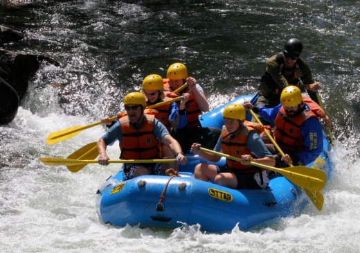

# Welcome to Tom Willis's Personal Website

**VP of Software Engineering · Patent Consultant · Product Manager · Agile Coach · Intrapreneur · Entrepreneur**

---

## 🧩 About Me

I help people convert their passion into great software solutions.

As a senior software engineering and product leader, I offer a proven opportunity to grow and transform your software organization with more agile, innovative, and productive teams. I bring an established record of delivering high-quality enterprise-scale commercial software aligned to customer needs. 

I am an **inventor**, **innovator**, and **IP expert** — known as a **business collaborator** supplying product management, technical insight, and leadership.

---

## 📈 Career Timeline

| Year | Role / Event |
|------|---------------|
| 2025 | Vice President, Flexion, Inc. |
| 2023 | Delivery Manager, Flexion, Inc. |
| 2020 | Product Owner, Flexion, Inc. |
| 2020 | 2 patents issued |
| 2019 | 2 patents filed · 3 patents issued |
| 2018 | 1 product launched · 2 patents issued |
| 2017 | VP of Engineering, Moxe Health · 3 patents issued |
| 2016 | Senior Manager, The Weather Company/IBM · Patent & software consultant |
| 2014–2015 | 12 patents filed |
| 2012 | Senior Manager, Dell Software |
| 2008 | Senior Manager, Quest Software |
| 2007 | Manager, Quest Software |
| 2005 | Team Lead, Quest Software |
| 2000 | Lead Software Engineer, Wingra Technologies |
| 1998 | Software Engineer, Wingra Technologies |

---

## 💬 What People Say

> “Tom is amazing. His efforts to *Do It Right* are fantastic. He works with everyone he comes into contact with easily and effectively. In addition, Tom is a driver as well as a team player.”  
> — *Manager, Flexion Inc.*

> “You are the best software R&D manager I have ever met. Your instruction on patent, best practices, design, and communication are very practical and constructive.”  
> — *Manager, Dell (Zhuhai, China)*

---

## 🌊 The Journey

Leading a team through the transition from traditional software development practices to modern, automated, agile DevOps best practices can be a lot like a **whitewater rafting adventure**.  

If everyone paddles on their own, you end up against the rocks. But when the team learns to trust each other — to observe and act in concert — you make headway.

The river is different on every ride. You don’t know what’s around the corner, but when the team gets into the rhythm of the **scrum or Kanban flow**, they’re prepared to adjust to changing conditions and deepen their understanding of the situation.

---

## 🙋‍♂️ Influences

My parents, my wife, and mentors such as **Jan Eddy**, **Steve Entine**, and **Mark Cathcart**.  
I’m also influenced by **Deming**, **Col. John Boyd**, and thinkers in **lean startup**, **DevOps**, and **agile** circles.

---

## 📬 Contact

- [LinkedIn](https://www.linkedin.com/in/tomaswillis/)
